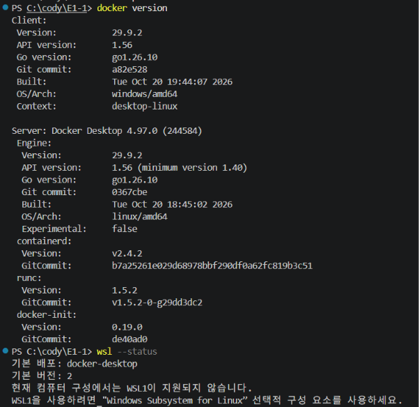
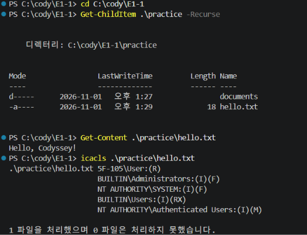
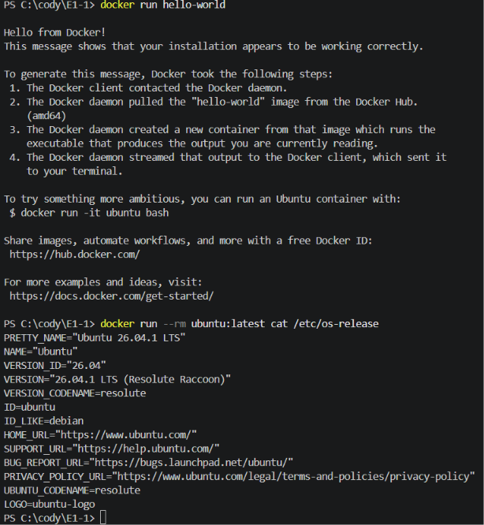
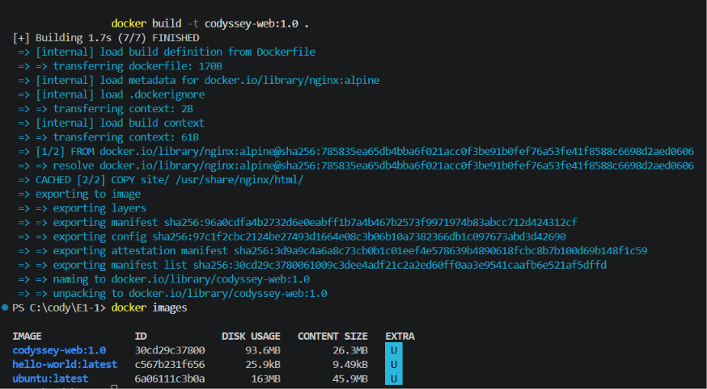
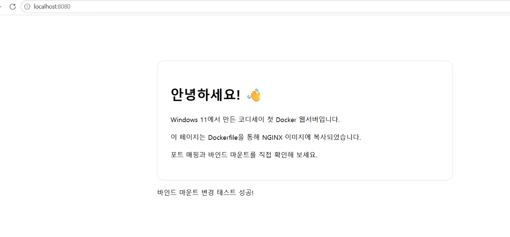
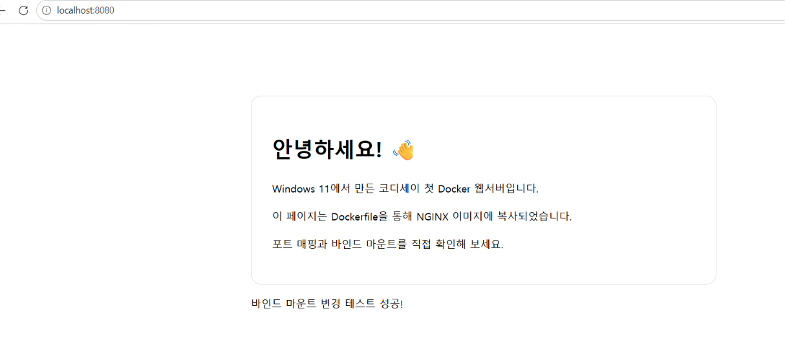
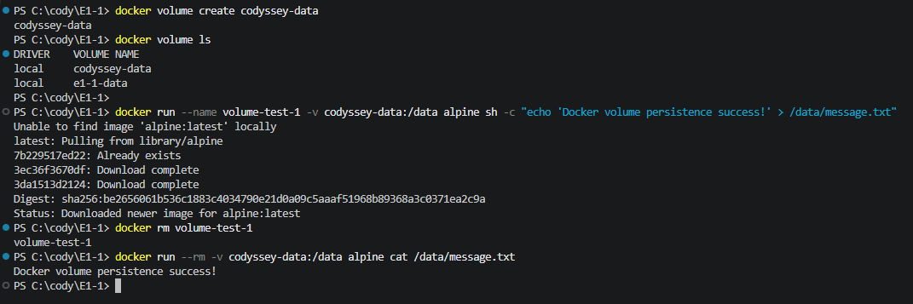

# 코디세이 개발 입문 — Windows 11 개발 작업실 구축

## 1. 프로젝트 개요

코디세이 개발 입문 필수 과제로, Windows 11 환경에 개발자용 작업실을 구성하고 PowerShell과 Docker를 활용한 기초 개발 환경 구축 및 컨테이너 실습을 진행했습니다.

터미널에서 파일과 디렉터리를 관리하고 Windows 파일 권한을 확인했으며, Docker 이미지와 컨테이너 실행, Dockerfile을 이용한 웹 서버 제작, 포트 매핑, 바인드 마운트, Named Volume의 데이터 영속성을 실습했습니다.

실습 과정에서 발생한 문제를 직접 확인하고 해결했으며, 주요 과정은 스크린샷으로 기록했습니다.

## 2. 개발 환경

| 항목 | 사용 환경 |
|---|---|
| 운영체제 | Windows 11 |
| 터미널 | Windows PowerShell |
| 에디터 | Visual Studio Code |
| 컨테이너 도구 | Docker Desktop |
| 컨테이너 실행 환경 | Docker Engine / WSL 2 |
| 웹 서버 | NGINX |
| 베이스 이미지 | nginx:alpine |
| 실습 저장소 | GitHub |

Docker Desktop을 실행한 뒤 Docker 엔진과 정상적으로 연결되는 것을 확인했습니다.

주요 확인 명령:

```powershell
docker version
wsl --status
```

**Docker 개발 환경 확인**



## 3. 프로젝트 구조

```text
E1-1/
├── Dockerfile
├── README.md
├── .gitignore
├── site/
│   └── index.html
├── practice/
│   └── documents/
├── screenshots/
│   ├── README.md
│   ├── 01_docker_environment.png
│   ├── 02_cli_file_permission.png
│   ├── 03_docker_basic_containers.png
│   ├── 04_custom_image_build.png
│   ├── 05_webserver_browser.png
│   ├── 06_bind_mount.png
│   └── 07_named_volume.png
└── logs/
    └── README.md
```

## 4. PowerShell 기초 명령 및 파일 권한 실습

PowerShell을 이용해 디렉터리와 파일을 생성하고, 파일 내용을 작성하고 확인하는 실습을 진행했습니다.

주요 실습 내용:

- 현재 작업 위치 확인
- 디렉터리 및 파일 생성
- 파일 내용 작성 및 읽기
- 파일 및 디렉터리 목록 확인
- 파일 권한 확인 및 변경
- 절대 경로와 상대 경로 이해

실습에 사용한 주요 명령:

```powershell
Get-Location
Get-ChildItem -Force

New-Item -ItemType Directory -Force .\practice\documents
New-Item -ItemType File -Force .\practice\documents\hello.txt

Set-Content .\practice\documents\hello.txt "Hello, Codyssey!"
Get-Content .\practice\documents\hello.txt

icacls .\practice\documents\hello.txt
icacls .\practice\documents\hello.txt /grant "$($env:USERNAME):(R)"
```

`icacls` 명령으로 Windows 파일 권한을 확인하고 현재 사용자에게 읽기 권한을 부여한 결과를 확인했습니다.

**PowerShell 파일 관리 및 권한 실습 결과**



## 5. Docker 기본 실습

Docker Desktop을 실행하고 Docker 엔진의 정상 작동 여부를 확인했습니다.

### 5-1. Hello World 컨테이너 실행

```powershell
docker run hello-world
```

Docker Hub에서 이미지를 내려받고 컨테이너를 실행하여 정상적으로 완료되는 것을 확인했습니다.

### 5-2. Ubuntu 컨테이너 실행

```powershell
docker run -it --name my-ubuntu ubuntu:latest bash
```

Ubuntu 컨테이너 내부에서 다음 명령을 실행했습니다.

```bash
ls
ls -a
ls -la
cat /etc/os-release
exit
```

컨테이너 내부의 디렉터리와 파일 목록을 확인하고 운영체제 정보를 확인했습니다.

실행한 Ubuntu 이미지의 운영체제 정보는 Ubuntu 26.04.1 LTS였습니다.

**Hello World 및 Ubuntu 컨테이너 실습 결과**



## 6. Dockerfile을 이용한 커스텀 웹 서버 제작

NGINX 공식 이미지를 기반으로 직접 작성한 웹 페이지를 컨테이너에서 실행할 수 있도록 Dockerfile을 작성했습니다.

### 6-1. Dockerfile

```dockerfile
FROM nginx:alpine

LABEL org.opencontainers.image.title="codyssey-custom-nginx"
ENV APP_ENV=dev

COPY site/ /usr/share/nginx/html/
```

각 명령의 역할:

| 명령 | 설명 |
|---|---|
| FROM | NGINX Alpine 이미지를 기본 이미지로 사용 |
| LABEL | 이미지에 이름 관련 메타데이터 추가 |
| ENV | 컨테이너 환경 변수 설정 |
| COPY | 로컬 site 디렉터리의 웹 파일을 컨테이너로 복사 |

### 6-2. 이미지 빌드

```powershell
docker build -t codyssey-web:1.0 .
```

Dockerfile을 이용해 `codyssey-web:1.0` 이미지를 빌드했습니다.

**커스텀 Docker 이미지 빌드 결과**



### 6-3. 웹 서버 실행

```powershell
docker run -d --name codyssey-web-container -p 8080:80 codyssey-web:1.0
```

브라우저에서 다음 주소로 접속하여 웹 페이지가 정상적으로 출력되는 것을 확인했습니다.

`http://localhost:8080`

호스트의 8080번 포트와 컨테이너 내부의 80번 포트를 연결하여 웹 서버에 접근했습니다.

**브라우저를 통한 웹 서버 접속 결과**



## 7. 바인드 마운트 실습

바인드 마운트는 호스트 컴퓨터의 특정 디렉터리를 컨테이너 내부 디렉터리와 연결하는 기능입니다.

실습에서는 로컬 프로젝트의 `site` 디렉터리를 NGINX 컨테이너의 웹 루트 디렉터리에 연결했습니다.

```powershell
docker run -d --name codyssey-bind-container -p 8080:80 --mount "type=bind,source=C:\cody\E1-1\site,target=/usr/share/nginx/html" nginx:alpine
```

호스트 컴퓨터에서 `site/index.html` 파일을 수정한 뒤 브라우저를 새로고침하여 변경 내용이 컨테이너의 웹 페이지에도 반영되는 것을 확인했습니다.

추가한 테스트 문구:

```html
<p>바인드 마운트 변경 테스트 성공!</p>
```

이를 통해 호스트의 파일 변경 사항이 컨테이너 내부에 실시간으로 반영되는 것을 확인했습니다.

**바인드 마운트 변경 사항 반영 결과**



## 8. Named Volume 데이터 영속성 실습

Named Volume은 컨테이너와 독립적으로 데이터를 저장하여 컨테이너가 삭제되더라도 데이터를 유지할 수 있도록 하는 기능입니다.

### 8-1. 볼륨 생성

```powershell
docker volume create codyssey-data
```

### 8-2. 첫 번째 컨테이너에서 데이터 저장

```powershell
docker run --name volume-test-1 -v codyssey-data:/data alpine sh -c "echo 'Docker volume persistence success!' > /data/message.txt"
```

Named Volume에 테스트 데이터를 저장했습니다.

### 8-3. 첫 번째 컨테이너 삭제

```powershell
docker rm volume-test-1
```

데이터를 저장한 컨테이너를 삭제했습니다.

### 8-4. 새로운 컨테이너에서 데이터 확인

```powershell
docker run --rm -v codyssey-data:/data alpine cat /data/message.txt
```

첫 번째 컨테이너를 삭제한 뒤에도 새로운 컨테이너에서 기존 데이터가 정상적으로 출력되는 것을 확인했습니다.

확인된 출력:

```text
Docker volume persistence success!
```

이를 통해 Named Volume을 이용하면 컨테이너의 생명주기와 데이터 저장 공간을 분리할 수 있다는 점을 확인했습니다.

**Named Volume 데이터 영속성 확인 결과**



## 9. Git 및 GitHub 저장소 관리

실습 프로젝트를 Git으로 관리하고 GitHub 원격 저장소에 업로드했습니다.

GitHub 저장소:

[https://github.com/lyjkhy/E1-1](https://github.com/lyjkhy/E1-1)

프로젝트 변경 사항을 커밋하고 원격 저장소에 Push하여 작업 내용을 관리했습니다.

주요 명령:

```powershell
git status
git add .
git commit -m "Complete Docker workspace practice"
git push origin main
```

로컬 프로젝트와 GitHub 저장소가 정상적으로 연결되고 변경 사항이 원격 저장소에 반영되는 것을 확인했습니다.

## 10. 트러블슈팅

실습 중 실제로 발생한 문제와 해결 과정을 정리했습니다.

### 사례 1. Docker 데몬 연결 실패

**문제**

`docker version` 실행 시 Docker 데몬에 연결할 수 없다는 오류가 발생했습니다.

**원인**

Docker Desktop이 실행되지 않아 Docker 엔진과 통신할 수 없는 상태였습니다.

**해결 과정**

1. Docker Desktop을 실행했습니다.
2. Docker 엔진이 정상적으로 시작될 때까지 기다렸습니다.
3. PowerShell에서 `docker version`을 다시 실행했습니다.

**결과**

Docker Client와 Server 정보가 정상적으로 출력되어 Docker 엔진 연결을 확인했습니다.

### 사례 2. HTML 한글 인코딩 깨짐

**문제**

웹 브라우저에서 HTML 페이지를 확인했을 때 한글이 정상적으로 표시되지 않는 문제가 발생했습니다.

**원인**

HTML 파일의 문자 인코딩이 UTF-8로 올바르게 저장되지 않은 것으로 판단했습니다.

**해결 과정**

PowerShell에서 UTF-8 인코딩을 지정하여 HTML 파일을 다시 저장했습니다.

```powershell
Set-Content -Encoding utf8 .\site\index.html "웹 페이지 내용"
```

**결과**

브라우저에서 한글이 정상적으로 표시되는 것을 확인했습니다.

## 11. 최종 학습 정리

이번 과제를 통해 Windows 11 환경에서 개발 작업에 필요한 기본 도구를 설치하고 사용하는 방법을 익혔습니다.

특히 다음 내용을 직접 실습했습니다.

- PowerShell을 이용한 파일 및 디렉터리 관리
- Windows 파일 권한 확인 및 변경
- Docker 이미지 다운로드와 컨테이너 실행
- Ubuntu 컨테이너 내부 명령 실행
- Dockerfile 작성과 커스텀 이미지 빌드
- NGINX 웹 서버 실행 및 포트 매핑
- 바인드 마운트를 이용한 호스트 파일 변경 반영
- Named Volume을 이용한 데이터 영속성 확인
- Git과 GitHub를 이용한 프로젝트 버전 관리
- 실습 중 발생한 문제의 원인 확인 및 해결

단순히 명령어를 실행하는 데 그치지 않고, 컨테이너와 호스트의 관계, 데이터 저장 방식, 개발 환경에서 발생할 수 있는 오류의 해결 과정을 직접 경험할 수 있었습니다.

---

**GitHub Repository:** https://github.com/lyjkhy/E1-1

**과제명:** 내 컴퓨터에 개발자용 작업실 꾸미기

**진행 상태:** 필수 실습 및 스크린샷 정리 완료
